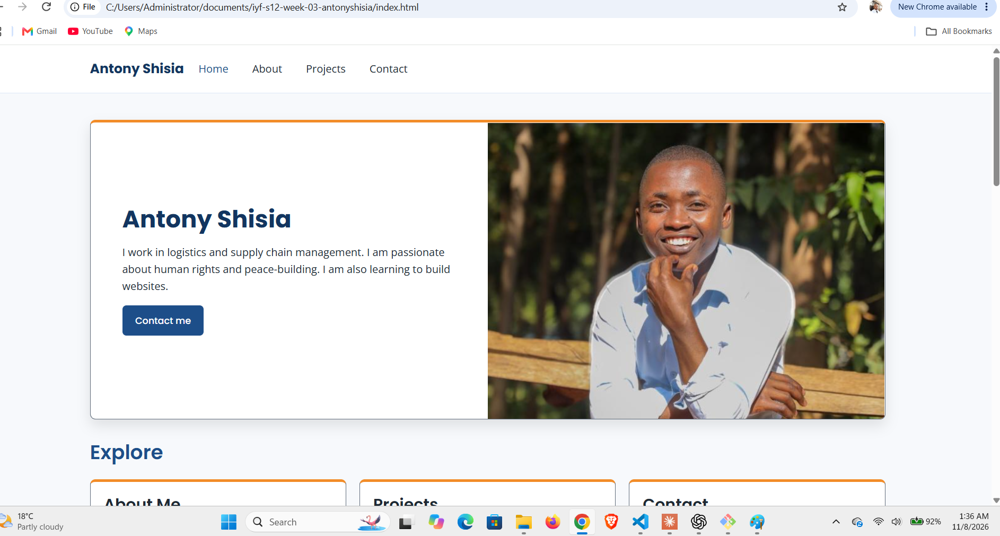

# Antony Shisia - Week 03 Project

A multi-page personal portfolio website built with HTML and CSS. This week I also learned how to work with GitHub remotes: pushing, cloning, pulling and ignoring files with `.gitignore`.

## Live Demo

[View Live Site](https://antonyshisia.github.io/iyf-s12-week-03-antonyshisia)

## Screenshot



## Features

- ✅ Multi-page layout (Home, About, Projects, Contact)
- ✅ Shared stylesheet across all pages
- ✅ Contact page
- ✅ Version controlled with Git and hosted on GitHub

## Technologies Used

- HTML5
- CSS3
- Git & GitHub
- Git Bash
- Visual Studio Code

## Project Structure

```
iyf-s12-week-03-antonyshisia/
├── .gitignore
├── README.md
├── index.html
├── about.html
├── projects.html
├── contact.html
├── styles.css
├── antony.png
├── notes.md
├── terminal-log.md
├── new-project.sh
└── images/
```

## What I Learned

- How to connect a local repository to GitHub and check the connection with `git remote -v`.
- How to push my work with `git push` and bring changes back with `git pull origin main`.
- How to simulate working on two computers by cloning my repository into a second folder, pushing a change from it, and pulling that change into the original.
- How to write a `.gitignore` file so that files like `node_modules/`, editor settings and temporary files stay out of my repository.
- How to read Git error messages, such as running a command outside a repository or mistyping `origin` and `-m`.

## Future Improvements

- [ ] Add JavaScript interactivity
- [ ] Implement dark mode
- [ ] Add project filtering

## Contact

- GitHub: [@antonyshisia](https://github.com/antonyshisia)

## License

This project is open source and available under the [MIT License](LICENSE).